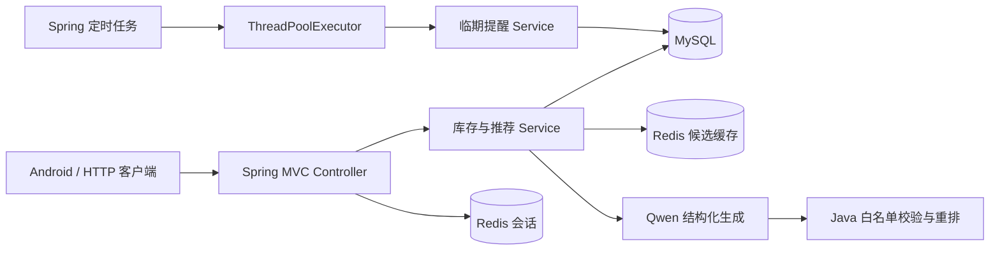

# FreshMind 智能食材临期与菜谱推荐系统

FreshMind 原本是一个 Android 单机食材管理应用。本仓库在保留客户端原型的基础上，增加了一个适合校招简历展示的单体后端：用户可以管理库存、查看临期食材、接收站内提醒，并让通义千问根据当前库存生成菜谱候选。

项目的重点不是堆技术，而是形成一条容易讲清楚的业务链路：

```text
库存 → LLM 生成候选 → Java 白名单校验 → 命中率/临期加分重排 → Redis 缓存
```

这里不是 Agent 或 AGI。一次推荐只进行一次结构化大模型调用，可靠性、权限和最终排序仍由后端代码控制。

## 1. 技术栈

| 方向 | 使用内容 |
| --- | --- |
| Java | Java 17、集合、Stream、JUC |
| Spring | Spring MVC、IoC、参数校验、事务、定时任务；Spring Boot 负责启动和配置 |
| 数据库 | MySQL、Spring Data JPA、索引、事务、乐观锁 |
| Redis | 登录会话、食材目录缓存、AI 菜谱候选缓存 |
| AI | 通义千问 OpenAI 兼容接口、JSON 结构化输出、超时与降级 |
| 测试 | JUnit 5、MockMvc、H2 MySQL 兼容模式 |

没有为了“分布式”强行加入 Netty、Dubbo 或 ZooKeeper。当前业务适合单体应用；只有真正拆分服务后，这些技术才有合理场景。

## 2. 核心功能

- 注册、登录、退出；密码使用 BCrypt 保存。
- 登录 token 存入 Redis，并设置两小时过期时间。
- 食材库存新增、查询、修改、删除和部分消耗。
- 根据 30 种食材目录估算保质期，计算新鲜、临期、过期状态。
- 通义千问生成菜谱候选；Java 校验食材、步骤和数值后重新计算推荐分数。
- 相同用户、相同库存摘要复用 Redis 候选结果，库存变化后自动生成新缓存键。
- 模型未配置、超时或返回无效内容时使用受控的本地降级，不让接口直接失败。
- 每日扫描临期库存，使用有界线程池并行生成站内提醒。
- 用户只能访问自己的库存和提醒。

## 3. 架构



后端目录：

```text
backend/src/main/java/com/freshmind/backend/
├── auth/          注册、登录、退出
├── session/       Redis 会话与 MVC 拦截器
├── inventory/     库存、保质期和状态计算
├── ai/            千问客户端、结构化 DTO、校验与缓存边界
├── recipe/        推荐打分与接口
├── notification/ JUC 临期提醒任务
├── dashboard/     首页汇总（不阻塞等待 AI）
├── catalog/       食材目录
└── common/        配置与统一错误响应
```

## 4. 本地运行

### 4.1 零依赖演示模式

该模式使用 H2、内存会话和确定性菜谱生成器，不要求安装 MySQL、Redis，也不会访问外部模型：

```powershell
.\gradlew.bat -p backend bootRun --args="--spring.profiles.active=local"
```

服务地址：`http://localhost:8080`。

### 4.2 MySQL + Redis + 通义千问

需要 Java 17、MySQL 8 和 Redis。先创建数据库：

```sql
CREATE DATABASE freshmind
  CHARACTER SET utf8mb4
  COLLATE utf8mb4_unicode_ci;
```

密钥只通过环境变量注入，不要写入 `application.yml`、HTTP 示例或 Git。若密钥曾在聊天、截图或提交中出现，请先在控制台轮换，再使用新密钥。

```powershell
$env:DB_URL = 'jdbc:mysql://localhost:3306/freshmind?useUnicode=true&characterEncoding=utf8&serverTimezone=Asia/Shanghai&useSSL=false&allowPublicKeyRetrieval=true'
$env:DB_USERNAME = 'root'
$env:DB_PASSWORD = '你的MySQL密码'
$env:REDIS_HOST = 'localhost'
$env:REDIS_PORT = '6379'
$env:DASHSCOPE_API_KEY = '<your-new-key>'
.\gradlew.bat -p backend bootRun
```

可选 AI 配置：

| 环境变量 | 默认值 | 含义 |
| --- | --- | --- |
| `AI_ENABLED` | `true` | 是否调用真实模型 |
| `AI_BASE_URL` | `https://dashscope.aliyuncs.com/compatible-mode/v1` | 百炼兼容模式地址，可按地域覆盖 |
| `AI_MODEL` | `qwen-plus` | 模型名称 |
| `AI_CANDIDATE_COUNT` | `8` | 每次生成候选数，范围 1～12 |
| `AI_TIMEOUT` | `PT20S` | 连接和读取超时 |

首次启动时 Hibernate 创建业务表，`SeedDataInitializer` 只写入 30 种食材，不再维护菜谱表。旧数据库如需移除历史菜谱表，请备份后手工执行 [docs/remove-legacy-recipe-tables.sql](docs/remove-legacy-recipe-tables.sql)；`ddl-auto=update` 不会自动删表。

食材名称、数量、单位和到期信息会发送到配置的大模型服务。不要在食材名称或单位中保存个人隐私。

## 5. 主要接口

注册或登录后，把响应中的 `token` 放入请求头 `X-Token`。

| 方法与路径 | 功能 |
| --- | --- |
| `POST /api/v1/auth/register` | 注册并创建会话 |
| `POST /api/v1/auth/login` | 登录 |
| `POST /api/v1/auth/logout` | 退出登录 |
| `GET /api/v1/ingredients` | 查询食材目录 |
| `POST /api/v1/inventory` | 新增库存 |
| `GET /api/v1/inventory` | 分页筛选库存 |
| `GET /api/v1/inventory/{id}` | 查询库存详情 |
| `PATCH /api/v1/inventory/{id}` | 修改库存 |
| `POST /api/v1/inventory/{id}/consume` | 消耗库存 |
| `DELETE /api/v1/inventory/{id}` | 删除库存 |
| `GET /api/v1/recommendations?limit=8` | 生成并排序菜谱推荐 |
| `GET /api/v1/dashboard` | 首页库存统计，不同步调用模型 |
| `GET /api/v1/notifications` | 查询临期提醒 |
| `PATCH /api/v1/notifications/{id}/read` | 标记提醒已读 |

可使用 [backend/api-demo.http](backend/api-demo.http) 走一遍核心接口。

## 6. 关键设计

### AI 生成与 Java 规则兜底

1. 只把未过期、数量大于 0 且能命中食材目录的库存发送给模型，自定义文本不会直接成为提示指令。
2. 模型只能从食材目录中选择食材，并返回 JSON；后端拒绝未知/重复食材、非法数量、空步骤和异常烹饪时间。
3. 模型不负责给分。Java 重新计算 `matchRate`、缺失食材和临期加分，再稳定排序。
4. 候选缓存键由 `用户 ID + 库存 SHA-256 指纹 + 模型 + 提示词版本 + 食材目录版本` 组成，不包含接口的 `limit`。
5. AI 候选缓存 15 分钟；模型错误和空结果不进入缓存。模型不可用时生成一个只使用已知库存的简单降级菜谱。

这种拆分保留了 LLM 的生成能力，又避免把模型输出当成可信业务数据。

### Redis 会话与缓存

- 登录成功生成随机 token，保存为 `session:{token} -> userId`，TTL 为两小时。
- MVC 拦截器解析 `X-Token`，业务查询继续使用 `owner_id` 隔离数据。
- 食材目录缓存 30 分钟；AI 候选缓存 15 分钟。用户库存不直接缓存，避免数据库与缓存双写。
- 测试和 `local` profile 使用内存实现，因此不依赖 Redis。

### MySQL 事务与乐观锁

- 库存新增、修改、消费、删除都在事务中完成。
- `inventory_items.version` 由 JPA `@Version` 管理，避免并发更新丢失。
- 查询围绕 `owner_id`、`expires_on` 和食材名称设计；用户 ID 同时承担数据隔离边界。

### JUC 临期提醒

- 定时任务每天查询未来两天内到期的库存。
- 使用 `ThreadPoolExecutor`：核心线程 2、最大线程 4、有界队列 100。
- 队列满时使用 `CallerRunsPolicy` 形成反压，不静默丢弃提醒。
- 唯一约束保证重复扫描不会生成重复提醒；关闭应用时执行优雅停机。

## 7. 测试

```powershell
.\gradlew.bat -p backend clean test
```

测试覆盖保质期边界、登录会话、库存 CRUD、用户隔离、推荐重排、模型输出白名单、缓存键、Redis 序列化、密钥脱敏、JUC 提醒幂等和参数错误。普通测试不访问真实模型，也不需要真实密钥。

## 8. 简历表述

> 基于 Spring MVC、MySQL 和 Redis 将 Android 食材管理原型扩展为多用户后端，实现库存 CRUD、临期看板、Redis TTL 会话和用户数据隔离。

> 接入通义千问结构化输出，根据库存生成菜谱候选；在 Java 侧完成食材白名单校验、命中率重算与临期加分排序，并通过库存指纹缓存、超时和本地降级控制延迟与外部服务异常。

> 使用有界 `ThreadPoolExecutor` 执行每日临期提醒任务，通过唯一约束、`CallerRunsPolicy` 和优雅停机保证任务幂等且不静默丢失。

更多面试说明见 [docs/resume-notes.md](docs/resume-notes.md)。

## 9. 当前边界

- Android 客户端仍使用原来的本地静态菜谱，尚未接入新 API；本次改造聚焦后端。
- 这是“LLM 结构化生成 + 后端规则重排”，没有工具调用、规划循环或长期记忆，因此不称 Agent。
- 登录方案定位为学习项目的 Redis token 会话，不包装成完整生产级认证系统。
- 当前是单体服务；只有业务确实需要拆分时，才考虑 Dubbo + ZooKeeper。

